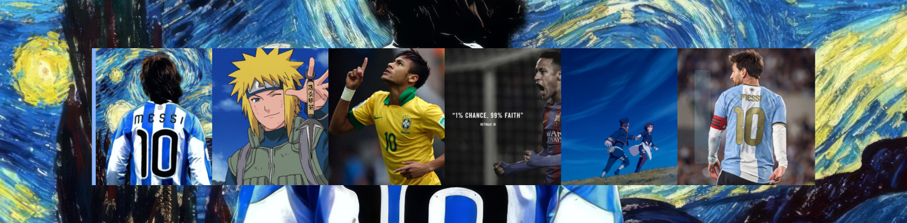

# rofi-wallpaper-changer

A minimal wallpaper switcher using rofi, with a horizontal picker of overlapping
square cards. Built for **Arch Linux + Hyprland**.



## Features

- **Overlapping square cards** — thumbnails are center-cropped to 250×250,
  cached, and drawn as 220 px cards that stack over each other
  (`spacing: -40px`), so each card covers the previous one's right edge.
- **Centered row** — any row narrower than the picker is centered instead of
  hugging the left edge, whether the folder holds two images or twenty.
- **Left accent selection** — the selected card gets a blue bar on its left
  edge. Rofi paints selection frames above the neighbouring card, so a full
  frame would spill over the overlap; the left edge is the part that is always
  visible.
- **No text at all** — no filenames, labels or footer; only the thumbnails are
  drawn.
- **Current wallpaper preselected** — the picker opens on the wallpaper you are
  already using, so pressing Enter is a safe no-op.
- **Fast, incremental cache** — thumbnails are generated in parallel and keyed
  by filename, mtime and size. Adding or replacing an image regenerates only
  that card; everything else is a cache hit.
- **One call per change** — applies to every monitor through a single
  `hyprctl hyprpaper wallpaper ",<path>"` request (with a legacy fallback).
- **No `jq` dependency.**
- **No panel behind them** — the cards float directly over your desktop; the
  window itself is fully transparent.

## Dependencies

- `rofi`
- `hyprpaper`
- `hyprland` (`hyprctl`)
- `imagemagick` (optional but recommended — without it the picker uses the
  full-size original as the icon, which is slower and un-cropped)

`jq` is no longer required.

## Install

```bash
bash <(curl -s https://raw.githubusercontent.com/agmonetti/rofi-wallpaper-changer/main/install.sh)
```

The installer asks for your wallpapers folder, saves it to
`~/.config/rofi-wallpaper-changer/wall_dir`, and never overwrites an existing
`hyprpaper.conf`.

## Manual install

```bash
git clone https://github.com/agmonetti/rofi-wallpaper-changer.git
cd rofi-wallpaper-changer

mkdir -p ~/.config/rofi ~/.local/bin

cp wallpapers.rasi ~/.config/rofi/
cp change_wall.sh ~/.local/bin/change_wall
cp restore_wall.sh ~/.local/bin/restore_wall

chmod +x ~/.local/bin/change_wall ~/.local/bin/restore_wall
```

Then point it at your wallpapers, either in your shell config:

```bash
export ROFI_WALL_DIR=~/your/wallpapers/folder
```

or in the config file used by both scripts:

```bash
echo ~/your/wallpapers/folder > ~/.config/rofi-wallpaper-changer/wall_dir
```

## Hyprland setup

Add these lines to your `~/.config/hypr/hyprland.conf`:

```
exec-once = hyprpaper
exec-once = restore_wall
bind = $mainMod, W, exec, ~/.local/bin/change_wall
```

On every boot, `restore_wall` restores the last wallpaper you picked. On first
run it picks the first image in your folder alphabetically.

## Usage

Run it from a terminal or with the keybind above:

```bash
change_wall
```

- Navigate with the arrow keys (`←` / `→`).
- Type to filter by filename (case-insensitive).
- Confirm with Enter; cancel with Escape.
- Only items from the list can be selected.

Thumbnails can be pre-built without opening the picker:

```bash
change_wall --warm
```

`restore_wall` runs this in the background at login.

## How it works

1. `change_wall` scans the wallpaper folder and builds any missing thumbnails.
2. Thumbnails are center-cropped to 250×250 squares and cached in
   `~/.cache/rofi-wallpapers/`.
3. The list is rotated so the current wallpaper is the first, preselected card.
   Any extra space is split into equal left and right margins.
4. rofi draws the cards directly over the desktop, with the row centered when it
   fits.
5. On Enter the wallpaper is applied to all monitors in one `hyprctl` call and
   the full path is written to `~/.cache/last_wallpaper`.
6. At login, `restore_wall` waits for hyprpaper's IPC, reapplies that path and
   warms the thumbnail cache in the background.

## Configuration

| Variable | Default | Description |
| --- | --- | --- |
| `ROFI_WALL_DIR` | value from `wall_dir`, else `~/wallpapers` | Wallpaper folder |
| `ROFI_WALLPAPER_THEME` | `~/.config/rofi/wallpapers.rasi` | Picker theme |

### wallpapers.rasi

| Property | Default | Description |
| --- | --- | --- |
| `width` | `80%` | Panel width |
| `height` | `270px` | Panel height |
| `spacing` | `-40px` | Negative spacing = card overlap |
| `size` (element-icon) | `220px` | Thumbnail display size |
| `border` (element) | `0px 0px 0px 6px` | Reserved left edge; `element selected` colors it with `#89b4fa` |

The picker no longer needs your monitor resolution. `change_wall` reads the
window width, padding, icon size and spacing from the theme plus the focused
monitor from `hyprctl`, and adds a left margin so the cards stay centered. If
the row is wider than the picker the margin is zero and the list scrolls as
usual.

### Thumbnail cache

Thumbnails live in `~/.cache/rofi-wallpapers/<folder-hash>/`, named
`<name-hash>.<mtime>.<size>.png`. Because the key includes the full filename,
mtime and size, changing
an image — even while keeping its filename — produces a new thumbnail and the
old one is swept automatically.

If you ever want a fresh start:

```bash
rm -rf ~/.cache/rofi-wallpapers
```

Caches from older versions are removed automatically on the first run.

## Notes

- Works with multiple monitors: an empty monitor selector applies the wallpaper
  to all of them.
- hyprpaper 0.8+ is supported directly; older versions use the
  preload/unload fallback.
- Files whose names contain a comma or newline are skipped, because both the
  rofi entry format and hyprpaper's request syntax use those characters as
  separators.
- The picker is intentionally flat: no subfolders or recursion.
